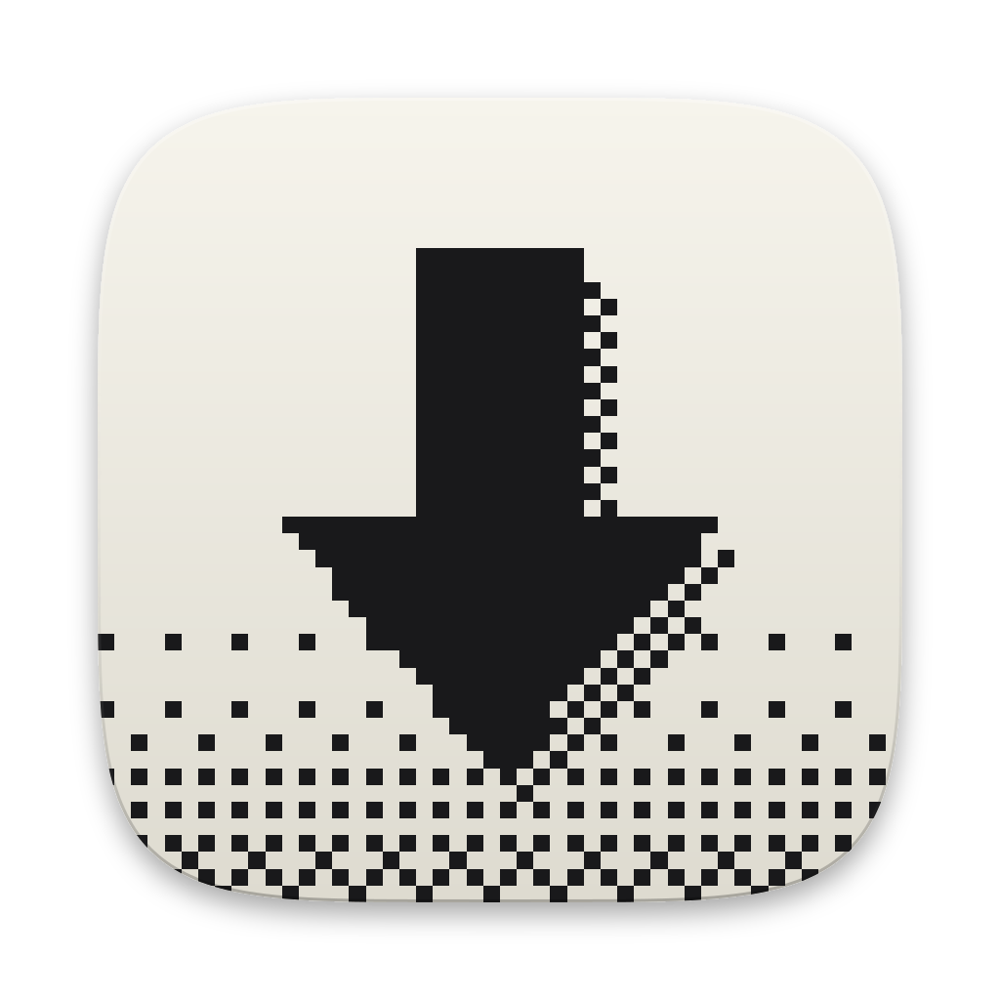
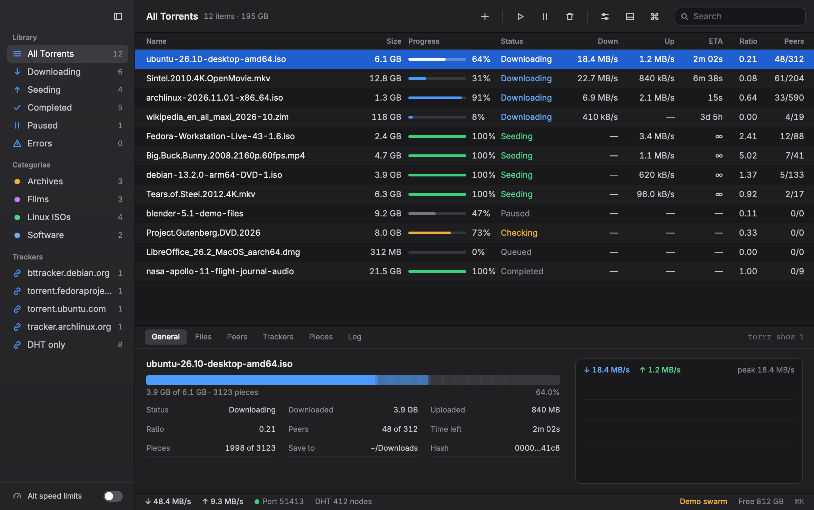
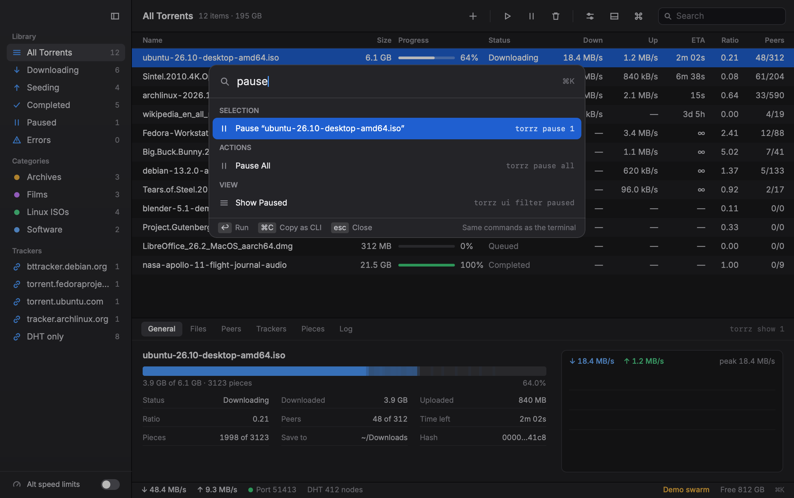

# Torrz

A desktop BitTorrent client whose every control is also a command.

Anything you can click in the window, you can run from a terminal as `torrz …`, and the
window shows you the command for what you just clicked. The window is drawn with
[Rune](https://github.com/anomalyco/rune); the torrent engine is
[librqbit](https://github.com/ikatson/rqbit). Both are Rust, and so is everything in between.



> **Status:** early. It downloads and seeds real torrents and is tested on macOS. Linux
> should build but is untested; Windows has no command line yet. See
> [what is missing](#what-is-missing).

## Features

- **A proper desktop window.** A source list with filters, categories and trackers; a
  sortable table; an inspector with files, peers (ranked by live speed, with a bar of where
  the download is coming from), trackers, a dithered piece map that animates as pieces
  arrive, and a speed graph.
- **A command for everything.** Selecting a row, switching a tab, opening a dialog and
  ticking a checkbox each have a `torrz` line. A test fails the build if a control is added
  without one.
- **A command palette.** ⌘K lists every action beside its command line; ⌘C copies the line.
- **A command log.** The inspector's Log tab records each click and each CLI call as the
  line that ran, with its result.
- **Real BitTorrent.** Magnet links, DHT, peer exchange, uTP, UDP trackers, private
  torrents, per-file selection, fast resume, speed limits and UPnP, all from librqbit.
- **Magnet links and a watched folder.** Magnet links from a browser open in the Add
  dialog, and a folder you choose is watched for `.torrent` files, which are added as they
  arrive and, if you like, moved to the Trash.
- **Better-connected torrents.** Torrz takes newTrackon's list of public trackers that stay
  up, probes each from your machine, and adds the fastest 20 to a torrent (or to every new
  one). Private torrents are never touched.
- **A demo mode.** `--demo` runs a simulated swarm, so you can try the whole interface
  without touching the network or the disk.

## Install

You need a recent Rust toolchain (the project is built with 1.99) and, for the Mac app
bundle, Xcode.

```sh
git clone https://github.com/imran-vz/torrz
cd torrz
```

**As a Mac app** (has the icon and takes `magnet:` links):

```sh
scripts/make-app.sh
cp -R dist/Torrz.app /Applications/
```

If another torrent app already opens magnet links, macOS keeps sending them there. Choose
"Open Magnet Links with Torrz" in the palette (or the link at the bottom of the Add dialog,
or `torrz ui default-app`) and confirm when macOS asks.

The bundle contains the `torrz` command too, at `Torrz.app/Contents/MacOS/torrz`.

**As plain binaries** on your `PATH`:

```sh
cargo install --path crates/torrz-app
cargo install --path crates/torrz-cli
```

Install both: `torrz open` starts the `torrz-app` that sits beside it.

The bundle is signed ad hoc, not notarised. If you copy it to another Mac, macOS will ask
you to approve it the first time.

## Quick start

```sh
torrz open                 # start the app (real engine, saves to ~/Downloads)
torrz open --demo          # or a simulated swarm that downloads nothing
```

With the window open, drive it from another terminal:

```sh
torrz add 'magnet:?xt=urn:btih:…' --category "Linux ISOs"
torrz list
torrz pause 1 2                    # ids, info hashes, `all` or `selected`
torrz files 1 --skip 3             # don't download file 3
torrz limit --down 12M --up none
torrz ui filter downloading        # what the sidebar does
torrz ui select 1                  # what clicking a row does
torrz ui tab peers
torrz ui palette on --query pause
torrz ui state                     # everything the window shows, as JSON
```

Every command takes `--json` for the raw answer and exits non-zero when it fails, so it
scripts cleanly:

```sh
torrz list --json | jq -r '.data[] | select(.state == "seeding") | .name'
```

The full list is in the [CLI reference](docs/cli.md), or `torrz --help`.

## In the window



| Key | Does |
|---|---|
| ⌘K | Open the command palette |
| ⌘O or ⌘N | Add a torrent |
| ⌘F | Search by name |
| Space | Pause or resume the selection |
| ⌫ | Remove the selection (asks first) |
| ↑ ↓ | Move the selection; with ⇧, extend it |
| ⌘A | Select every row shown |
| ⌘1 … ⌘6 | Inspector tab: General, Files, Peers, Trackers, Pieces, Log |
| ⌘I | Show or hide the inspector |
| ⌥⌘S | Show or hide the sidebar |
| ⌘, | Speed limits |
| Esc | Close the palette or dialog, then clear the search, then the selection |

Click a row to select it, ⌘-click to add or remove one, ⇧-click to select a range, and
double-click to show its files in Finder. Right-click a row (or select it and press Shift+F10)
for its menu: Resume or Pause, Show Files, Reveal in Finder, Copy (name, info hash or magnet
link), Category, Add Best Trackers and Remove. Each item runs the `torrz` line it names.

The Trackers tab has "Add Best Trackers" for the torrent it shows, and a box that gives every
new torrent the best trackers as it is added (`torrz trackers auto on`). "Best" means:
newTrackon's stable list (trackers with 95% uptime or better), without IPv6-only trackers if
your Mac has no IPv6, each probed from here with a real UDP handshake or HTTP request.
Silent ones are dropped, each host keeps its fastest address, and the fastest 20 are kept.
The ranking is reused for six hours; "Rank the Public Trackers Again" in the palette, or
`torrz trackers best --refresh`, redoes it.

librqbit fixes a torrent's trackers when it starts, so giving a running torrent more means
adding it again with them. Torrz keeps its files, its file choices, whether it was paused and
its resume data, so it comes back after a spot check rather than a full re-check. Its
upload count starts again from zero. Drop a `.torrent` file on the window to add it.
When the Add dialog holds a `.torrent` file, "Move the .torrent file to the Trash" sends it
there once it is added; the next Add dialog remembers the choice.

The folder button in the toolbar watches a folder (`torrz watch <dir>`): each `.torrent`
file that lands in it is added, and moved to the Trash if you tick the box. Files already in
the folder are left alone. While a folder is watched, the status bar says so; click it to
change or stop it.
Closing the window leaves the torrents running; quit from the palette or with
`torrz ui window quit`.

The app icon has a light and a dark version. It follows the system by default; choose one
from the palette ("App Icon") or with `torrz ui icon auto|light|dark`.

## Documentation

- [CLI reference](docs/cli.md): every command, with the JSON it returns.
- [Architecture](docs/architecture.md): how a click and a command line become the same
  thing, the threads, and the socket protocol.
- [Development](docs/development.md): building, testing, headless screenshots, adding a
  command, the icon and the bundle, and updating Rune.
- [Contributing](CONTRIBUTING.md).

## Where things are kept

| What | Where |
|---|---|
| Downloads | `~/Downloads` |
| Settings (limits, categories, icon, watched folder) | `config.json` in the data folder |
| Torrent list and resume data | `session/` in the data folder |
| Command socket | `torrz.sock` in the data folder |

The data folder is `~/Library/Application Support/Torrz` on macOS and
`$XDG_DATA_HOME/torrz` (or `~/.local/share/torrz`) elsewhere. Set `TORRZ_HOME` to move it
and `TORRZ_SOCK` to move only the socket. The demo keeps its settings in memory and never
writes `config.json`.

## What is missing

- **Windows:** the app may build, but the command socket is Unix-only, so `torrz` cannot
  reach it.
- **BitTorrent v2**, and piece picking other than in order. Both are librqbit's limits.
- **Settings:** the download folder (`~/Downloads`) and the listening port (51413) are
  fixed. `torrz add --dir` saves one torrent elsewhere.
- **In the window:** column resizing, a tray icon, and opening a `.torrent` by
  double-clicking it in Finder.
- **A forced light or dark icon** shows only while Torrz runs; when it is quit, macOS
  draws the version that matches the system.

## License

MIT. See [LICENSE](LICENSE).

Created in [T3 Code](https://t3.codes).
